# Retro TV Launcher

An Android TV home screen with three retro skins — **Windows 98**, **Windows XP / Frutiger Aero** and **8-bit** —
that you switch **by voice** from the TV remote. Built for the living-room TV of a shared flat (a Xiaomi Mi Box S,
Android TV 11) on top of the open-source [Clean Your TV](https://github.com/Gathin23/cleanyourtv) launcher.

*Un inicio para Android TV con tres skins retro (Windows 98, Windows XP / Frutiger Aero y 8 bits) que se cambian
diciéndoselo al mando. Hecho para la tele de un piso compartido; la interfaz está en español.*

| Windows 98 | Frutiger Aero (XP) | 8-bit |
|---|---|---|
| 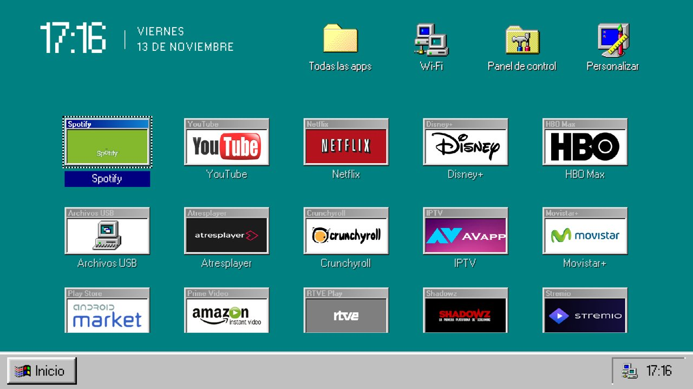 | 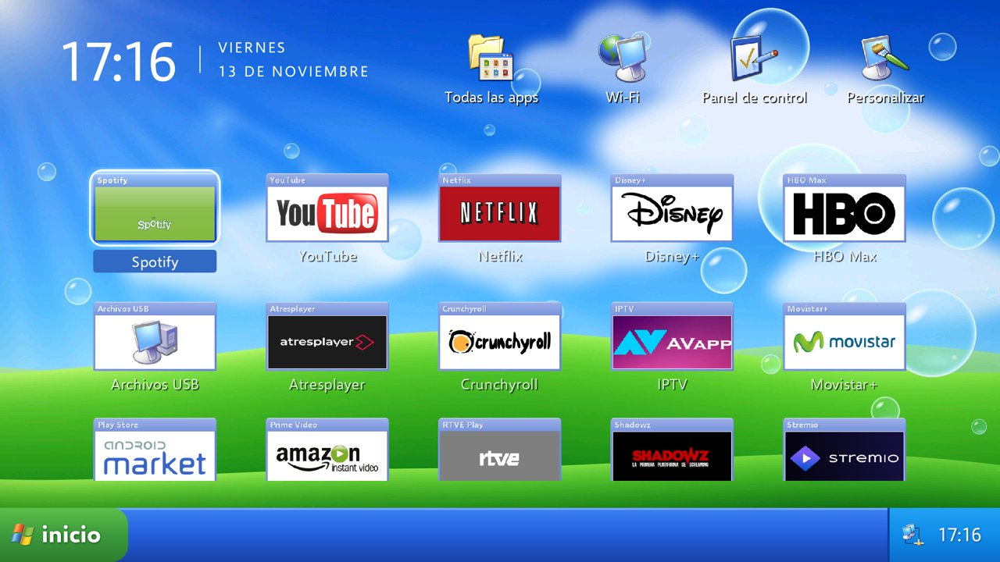 | 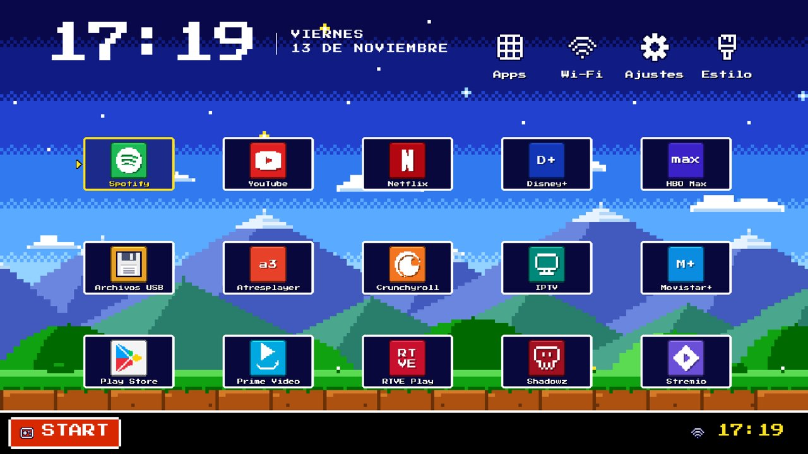 |

## What it does

- **Three complete skins, not just a wallpaper.** Every screen of the launcher follows the skin: the home grid,
  the "All apps" window, the tile menu, the launcher settings dialog, the full-screen clock / screensaver,
  toasts and dialogs.
  - *Windows 98*: teal desktop, each app as a window with a navy title bar when focused, dotted focus rectangle,
    taskbar with a working Start menu, MS Sans Serif-style font, starfield screensaver, **old logos** of each app
    (2006 YouTube, pre-2014 Netflix, Android Market…).
  - *Windows XP / Frutiger Aero*: original glossy sky-and-bubbles wallpaper, Luna windows, a **transparent glossy
    selector**, blue taskbar with the green Start button, XP icons, Selawik font.
  - *8-bit*: original pixel landscape, apps as NES-style dialog boxes with a yellow frame and ▶ cursor,
    pixel-art icons for every app, HUD-style bar with a red START button, Press Start 2P font, chunky pixel stars.
- **Function over looks.** Everything that looks like a button works: Start menu (all apps, TV settings, Wi-Fi,
  reorder, launcher settings, clock), desktop icons, tray icon. Decorative "fake" buttons were removed.
- **Voice switching.** Press the remote's mic and say *"Windows 98"*, *"Frutiger Aero"* or *"8 bits"*. The
  assistant on these boxes can't open launcher entries by name (it just searches YouTube), so an accessibility
  service reads what the assistant understood on its search screen and, if it is a skin name, switches the skin.
- **One APK, switch at runtime.** All three skins' fonts, drawables and palettes live in the same build; the skin
  files (config, wallpaper, tiles, icons) are stored on the box and swapped by `SkinActivity`.

| Start menu | All apps | Settings | Screensaver |
|---|---|---|---|
| 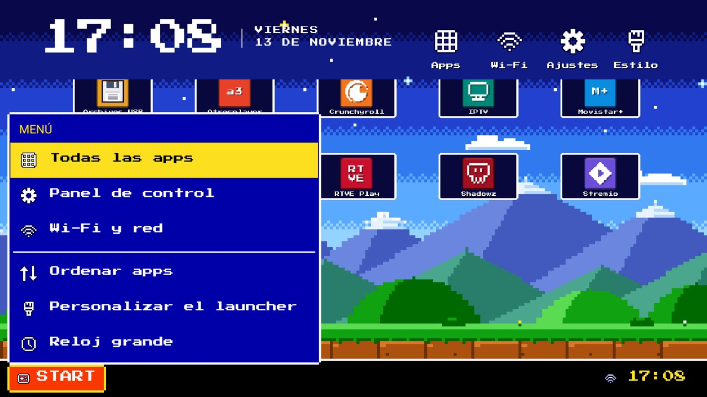 | 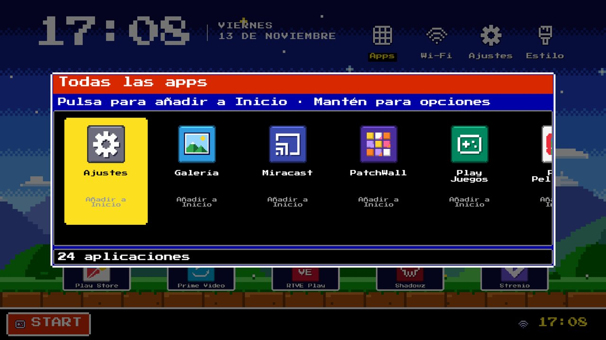 | 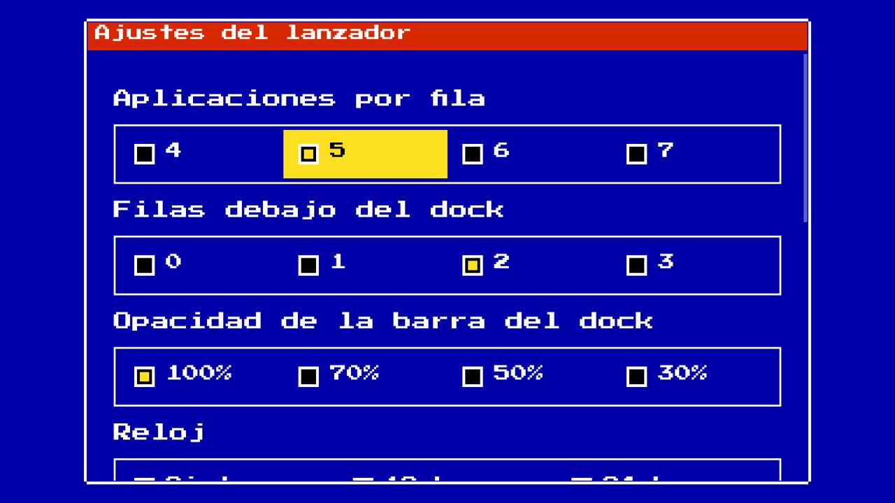 | 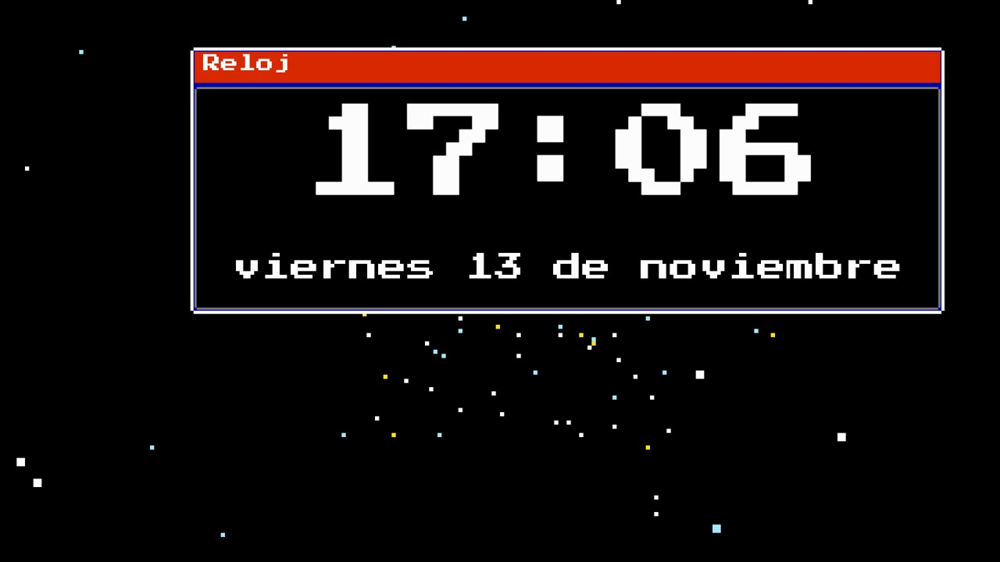 |
| 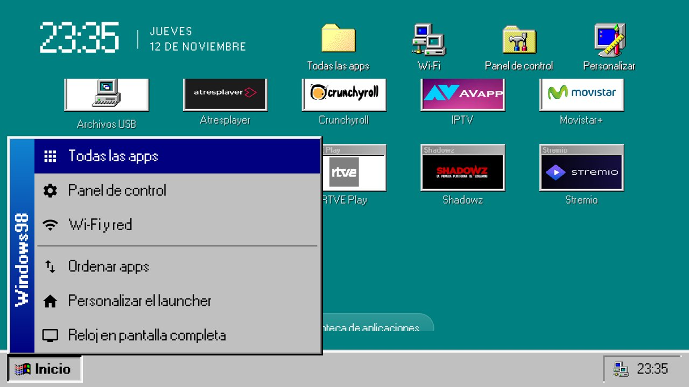 | 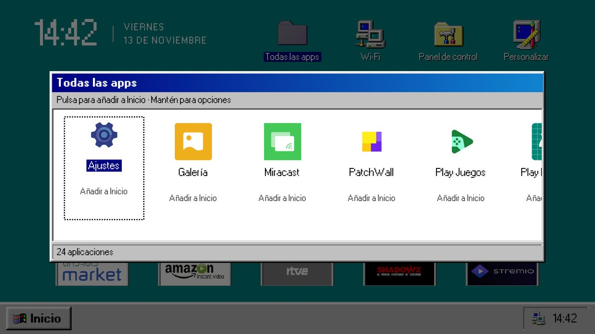 | 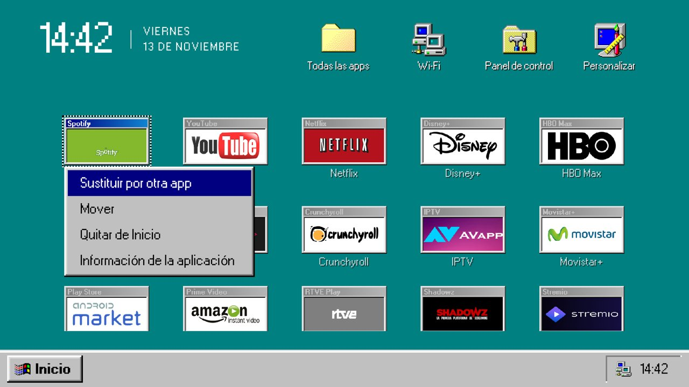 | 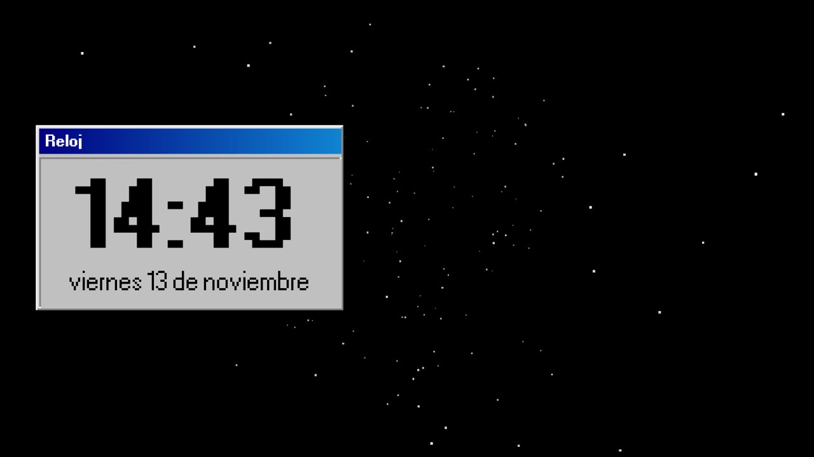 |

## How it works

| Piece | Where |
|---|---|
| Skin selection: `glass_style` = `win98` / `xp` / `8bit` in the theme; palette, per-skin drawables (`w98_*`, `xp_*`, `bit_*`) and fonts | `Win98.java`, `Config.java`, `res/raw/keep.xml` (keeps drawables looked up by name from resource shrinking) |
| Focus highlight per skin (dotted rectangle, glossy glass bubble, none for 8-bit) | `GlassView.java` |
| Tiles and icons from the theme folder (`banners/<pkg>.png`, `_on.png` when focused; `icons/<pkg>.png`) | `AppAdapter.java`, `ThemeFiles.java` |
| Taskbar, Start menu, desktop icons | `MainActivity.applyWin98()`, `showStartMenu()`, `deskIcon()` |
| All apps, menus, settings, screensaver | `AppLibraryDialog.java`, `Win98Menus.java`, `Win98Settings.java`, `Win98Saver.java` |
| Skin switching and voice | `SkinActivity.java` (copies `skins/<name>/` over the live theme and restarts Home), `SkinVoiceService.java` |

The artwork is generated by Python scripts in `generators/` (Pillow): wallpapers drawn in code, tile banners as
Win98 / XP windows or NES boxes, and 32×32 pixel-art icons.

## Try it

You need an Android TV box with adb over the network enabled, and the Android SDK + JDK 17 to build.

```sh
export TV=192.168.1.50:5555          # your box
export ANDROID_HOME=~/Android/sdk
scripts/build.sh                      # build the APK
scripts/install.sh                    # install it (first time: also make it the Home app, see android/build-and-install.sh)
scripts/push-skins.sh                 # store the three skins on the box
scripts/enable-voice.sh               # turn on voice switching
scripts/skin.sh 8bit                  # or win98 / xp
scripts/test-voice.sh "Windows 98"    # same as saying it to the remote
```

`skins/*/config.json` lists the apps on the dock and the hidden ones for one particular box; edit them for yours.

## Credits

Built on [Clean Your TV](https://github.com/Gathin23/cleanyourtv) by Gathin (MIT). Fonts, Windows icons and app
logos belong to their owners — see [NOTICE.md](NOTICE.md). Non-commercial fan project.
